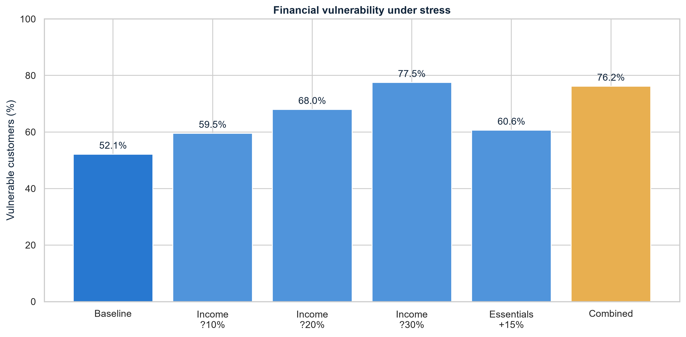

# VITT Financial Analytics

A Python and Power BI project that explores customer finances, investment risk-taking capacity, and financial stress. All 3,000 customer profiles are fictional. Amounts are in INR. The models are illustrative, not investment advice.

## Project files

- `dashboard/VITT_Financial_Intelligence.pbix`: Interactive Power BI dashboard.
- `Vitt_Analysis.ipynb`: Executed notebook with calculations, explanations, charts, and checks.
- `data/`: Permanent raw customer CSV, processed customer CSV, and stress scenario summary.
- `graphs/`: Seven charts exported by the notebook.

## Preview



## Run the analysis

Install the packages once:

```text
python -m pip install pandas numpy matplotlib seaborn jupyterlab ipykernel
```

Open this folder in VS Code, open `Vitt_Analysis.ipynb`, choose your Python kernel, and select Run All. Alternatively, run this command from the project folder:

```text
python -m jupyter lab Vitt_Analysis.ipynb
```

The notebook reads `data/synthetic_customers.csv`. It never regenerates or modifies that raw file. Running it updates the processed CSVs and graphs.

## Open the dashboard

Open `dashboard/VITT_Financial_Intelligence.pbix` in Power BI Desktop. It contains six KPI cards, four charts, and slicers for region, employment, and Risk Band. The imported data is included in the file.

If you move the folder to another computer, update the two CSV paths through Transform data > Data source settings before refreshing. Use `data/processed_customers.csv` and `data/stress_scenario_summary.csv`.

The dashboard uses native Power BI visuals and a blue theme. Its measures aggregate results already calculated in Python. The stress summary is a separate whole-population table.

Current slicers show bands present in the data. The requested full 1-to-10 band selector, explicit Select all controls, and zero-vulnerability display fix have not yet been applied.

## Financial metrics

Total monthly expenses = Essential expenses + Discretionary expenses

Monthly surplus = Monthly income - Total monthly expenses - Monthly EMI

Savings rate (%) = Monthly surplus / Monthly income * 100

DTI (%) = Monthly EMI / Monthly income * 100

Emergency coverage = Liquid savings / (Essential expenses + Monthly EMI)

Financially vulnerable = Coverage < 3 months OR DTI >= 40% OR Monthly surplus <= 0

Savings rate is potential savings capacity, not actual saving. DTI uses take-home income, rather than the gross income often used in lending. Negative surplus is retained.

## Risk Band and allocation

Risk Band describes investment risk-taking capacity and preference, not loan default probability.

Preference score = 0.15 for Conservative, 0.50 for Moderate, or 0.90 for Aggressive

Confidence score = Financial confidence score / 100

Horizon score = Investment horizon / 15, capped at 1

Emergency score = Emergency coverage / 6, capped at 1

Debt score = 1 - DTI percentage / 50, floored at 0

Risk Score = 0.40 * Preference + 0.20 * Confidence + 0.15 * Horizon + 0.15 * Emergency + 0.10 * Debt

Risk Band = 1 + round(9 * Risk Score)

The notebook maps each band to the supplied Vitt allocation dictionary. Safety, Income, Growth, and Aggressive percentages total 100%. These categories and weights are project assumptions.

Emergency reserve target = Target months * (Essential expenses + EMI)

Target months = 9 for bands 1 to 4, 6 for bands 5 to 7, and 3 for bands 8 to 10

Positive surplus fills the reserve shortfall first. Only the remainder is treated as potential investable surplus.

## Stress testing

The six scenarios are baseline, income reductions of 10%, 20%, and 30%, a 15% essential expense increase, and a combined 20% income reduction with 15% higher essential expenses.

Each scenario starts from the original baseline. Financial metrics and Risk Band are recalculated. Confidence, EMI, discretionary spending, assets, horizon, and preference stay unchanged.

## Results

- Total customers: 3,000.
- Average confidence: 58.00 out of 100.
- Average savings capacity: 21.22%.
- Average DTI: 18.84%.
- Median emergency coverage: 3.88 months.
- Financially vulnerable at baseline: 52.13%.
- Financially vulnerable under combined stress: 76.20%.
- Average savings capacity under combined stress: -6.90%.
- Negative-surplus customers increase from 538 to 1,713 under combined stress.

## Checks and limitations

The notebook checks input dimensions, unique IDs, valid values, scoring bounds, allocation totals, scenario isolation, vulnerability rules, and exports. A checksum confirms that the raw CSV remains unchanged during execution.

All customers are synthetic. Results do not describe real Indian customer behavior. Scoring weights, allocations, and reserve targets are unvalidated assumptions. Stress tests are monthly snapshots without behavioral changes or savings depletion. Some correlations result directly from shared formula inputs.

## Upload to GitHub

Create a repository named `Vitt-Financial-Analytics` and upload the contents of this folder, keeping the folders intact. The README will appear on the repository home page. Download the PBIX and open it in Power BI Desktop to explore the dashboard. GitHub does not display the interactive Power BI report.

